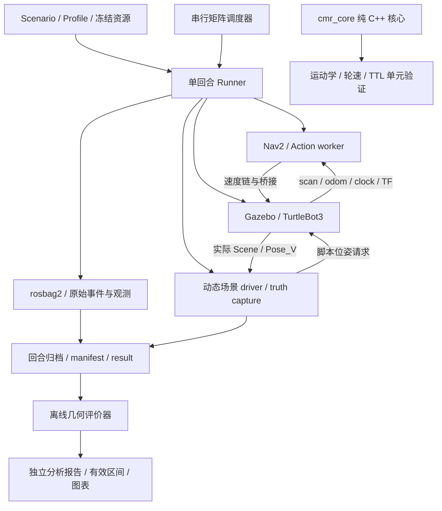

# Commercial Mobile Robot Core Project（CMR）

面向室内配送移动机器人的 C++ / ROS 2 工程项目：从可独立测试的运动学核心出发，建立导航、仿真、实验记录与离线评价链，再逐步实现配送任务与运动授权。

> **开发状态（2026-10-30）：主线切换至 P1，下一项为 P1-01 配送任务状态机。**
> P0-09 仅完成 README 文档收尾，其余验收与发布工作暂缓；不代表 P0-09 完整通过，也没有发布 v0.1。本文依据已有源码、日志与报告整理；本次文档重构仅做静态与离线验证，没有重新构建或运行仿真。

文档统一入口：[docs/README.md](docs/README.md)；[场景目录](docs/scenario_catalog.md)；[文档迁移记录](docs/verification/docs-layout-20261030.md)。

## 项目定位

项目以**单台差速机器人、单楼层、已知地图、人工装卸与交接**为边界，关注机器人软件开发中的状态管理、时间与进程所有权、失败处理和证据可追溯性。长期方向是局部规划与运动控制，后续再开展自主 MPPI、动态目标跟踪和风险校准。

当前 Phase 0 已建立实验基础设施：集成官方 Nav2 MPPI / DWB，使用 TurtleBot3 仿真验证单目标导航，通过脚本化动态障碍物采集数据，并用独立圆模型评价器分析指定对象对的间距。**这些成果不等于完整配送系统或商用安全认证。**

自主实现集中在 `cmr_core`、实验 runner、动态场景驱动/记录和离线几何评价；导航控制器、定位、代价地图及仿真引擎复用上游。范围决策见 [ADR 0001](docs/adr/0001-scope.md)，协作与来源见 [AI_USAGE](AI_USAGE.md)、[THIRD_PARTY](THIRD_PARTY.md)。

## 技术栈

| 层次 | 实际使用 |
|---|---|
| 开发环境 | Ubuntu 24.04 ARM64，macOS / UTM 虚拟机；Git |
| 核心与场景客户端 | C++17、标准库、CMake、CTest、ament / colcon；Gazebo Transport 13 / Msgs 10、nlohmann/json |
| 导航与通信 | ROS 2 Jazzy、Nav2、NavigateToPose Action、TF2、Fast DDS、ROS–Gazebo bridge |
| 仿真 | Gazebo Harmonic / Sim 8、TurtleBot3 Waffle；已验证的 Ogre1 / 软件渲染配置 |
| 实验与分析 | Python 3、rclpy、rosbag2 / MCAP、JSON Schema、PyYAML、pytest、matplotlib |

历史验收记录包含 Nav2 1.3.13、Gazebo Sim 8.15.0、Transport 13.6.0；具体回合以冻结 profile、依赖清单和运行快照为准，不能用本表替代版本核对。基础环境见 [环境说明](docs/guides/build-and-tests.md)。SQLite 与任务层 `rclcpp_action` 适配属于 P1 计划，当前尚无 `cmr_mission` 包。

## 系统架构



- **数值核心**：差速圆弧传播、小角度处理、左右轮速约束和带序号/TTL 的 `CommandGate`；可脱离 ROS 构建。当前没有作为 Nav2 最终速度出口接入。
- **导航链**：Nav2 控制器 → velocity smoother → Collision Monitor → ROS–Gazebo bridge → DiffDrive。实际插件和参数由运行快照核实，不凭配置文件名判断。
- **Runner**：负责启动、就绪检查、定位、录包、单 UUID 目标、停止观察、结果归档和有界清理；矩阵调度器串行调用同一生命周期，不另建仿真管理层。
- **动态场景**：C++ `cmr_scene_driver` 按仿真时间驱动道具，`cmr_truth_capture` 独立记录实际场景与位姿。请求位置、服务应答、实际 Pose_V 分开保存；真值用于评价，不作为 Nav2 感知输入。
- **评价器**：只读归档 Pose_V、实体身份、源时间和 collision 几何；分析输出写入新的评价目录，不回写原始 result。

## Phase 0 成果与验证层级

下表描述已有证据，不表示本次重新执行验收。已实现、单元/协议测试、真实仿真集成与个人确认分别记录；`VALID` 仅表示记录合同合法。

| 阶段 | 已实现 | 已有测试 / 集成证据 | 未验证或保留边界 |
|---|---|---|---|
| P0-01 核心 | C++17 运动学、轮速检查、命令序号与 TTL | 后续 Release、ASan/UBSan、colcon 均为 5/5 测试组；两种安装消费者各 1/1 | 不是主动停车器，无底盘/硬件验证；[合同](docs/contracts/core-contract.md) |
| P0-02 记录合同 | Scenario、manifest、result Schema，引用/hash 校验，真实记录与 fixture 区分 | 历史 115 项及合同修订后的 122 项回归；[交接](docs/verification/p0-02-RaLo7r83-handoff-20261022.md) | 历史测试有版本边界，Schema 合法不等于行为正确 |
| P0-03 最小导航 | Jazzy / Gazebo 通信、定位先于导航、单目标 Action | 后续功能交接有成功 UUID、运动及停止记录；正式完整双基线归档由 P0-04 补齐 | 早期拒绝/关闭失败保留；功能交接本身没有完整 manifest/result |
| P0-04 双基线 | 官方 MPPI / DWB，公共约束与运行参数核对 | 两个正式回合完成就绪、导航、停止及清理；[报告](docs/verification/p0-04-p0-04-pair-q2MXrdh3.md) | 原短静态任务，不是性能排名或动态双基线评价 |
| P0-05 单回合自动化 | 进程归属、期限、录包、异常归档与清理 | MPPI / DWB 各一正常回合及缺初值故障；[报告](docs/verification/p0-05-bmzezluh.md) | Action 成功、到达估计、停车、录包与清理须分别通过 |
| P0-06 动态场景 | 横穿 S1、已观测目标遮挡 S3，实际位姿与 scan 记录 | 原四轮及长路线四轮 MPPI 实测；长路线含 low / higher 宿主负载条件；[长路线报告](docs/verification/long-route-v1-20261029.md) | 脚本化运动学道具；没有动态 DWB 对照、tracker 或未知目标预测 |
| P0-07 几何评价 | 源时间对齐、缺口拒绝、圆包络有符号距离及线性段最小值 | 48 项几何测试、160 项旧合同/runner 回归；四旧记录与四长路线记录均有声明范围内 full 评价；[报告](docs/verification/p0-07-4v9sd2n4.md) | full 只针对声明对象对/区间，不证明全世界无碰撞 |
| P0-08 重复与故障 | 串行冷启动矩阵、意图账本、故障门及双向汇总 | 当前长路线正常 21 次尝试、20 次完整通过；6 次故障通过；216 项离线＋5 项隔离协议测试；[报告](docs/verification/p0-08-long-20261029-3cff94.md) | 1 次真实失败保留，个人理解/抽查待确认，无实车结论 |

P0-01 的[早期草稿](docs/verification/p0-01-gfGjKp8O-draft.md)停在待执行状态，后续原始日志位于 `evidence/env/p0-01-gfGjKp8O/`：`release-ctest.xml`、`sanitize-ctest.xml`、`colcon-test-result.txt` 及两个 consumer 日志。本次只读核对发现当前四个核心文件与 `selected-sha256-after.json` 一致；没有用草稿前的简版测试替代新增案例证据。

部分历史使用说明仍写有“08 仅静态预检”，那是长路线迁移时的状态；当前 08 结论以表中最新报告为准，历史文档和失败记录不改写。

## 项目目录

```text
commercial_mobile_robot/
├── src/
│   ├── cmr_core/             # core.hpp、纯 C++ 测试、独立/ament 构建
│   ├── cmr_bringup/config/   # Nav2 MPPI/DWB 参数与 DDS 配置
│   └── cmr_sim/             # 场景驱动/真值采集 C++、worlds、models
├── tools/
│   ├── run_trial.py         # 单回合唯一生命周期
│   ├── run_trial_observe.py # 可选 GUI 与人工发目标确认
│   ├── navigation/nav_goal.py # ROS Action、就绪及行为观测 worker
│   ├── run_smoke_matrix.py  # 串行正常/故障矩阵
│   ├── runner/inspect_bag.py # 关闭后的 MCAP 内容检查
│   ├── summarize_runs.py    # 结果与批次账本汇总
│   └── evaluate_geometry.py # 离线几何评价 CLI，纯算法在 tools/geometry/geometry_metrics.py
├── experiments/             # goals、scenarios、profiles、motions、schemas、evaluations
├── tests/                   # Python 测试及明确标注的合成 fixtures
├── docs/                    # 设计、运行说明、verification、failures
├── evidence/                # 本地原始证据：env、runs、batches、metrics（Git 忽略）
└── build/、install/、log/    # 本地构建产物（Git 忽略）
```

实验输入职责及历史版本恢复见[experiments/README.md](experiments/README.md)。

## 环境与运行

本机依赖、构建与测试边界见[构建与测试指南](docs/guides/build-and-tests.md)。项目包含本机绝对路径和冻结资源，evidence默认不入Git，尚不是clone-and-run发行包。

场景、任务和当前/历史输入配对以[场景目录](docs/scenario_catalog.md)为唯一文档入口。旧动态ready输入绑定迁移前源码，当前预检拒绝；新布局模板仍draft，不能直接用于正式导航。

- [单回合Runner](docs/guides/runner.md)：先只读预检，再按需启动仿真。
- [Gazebo观察](docs/guides/gazebo-observation.md)：同一Runner、人工发目标确认与显示边界。
- [动态准备](docs/guides/dynamic-scenes.md)：新版本输入与probe证据门。
- [几何评价](docs/guides/geometry-evaluation.md)：指定Run生成Concrete Spec、预检和独立报告。
- [批次实验](docs/guides/batch-experiments.md)：新cohort、失败恢复与离线汇总。

## 实验与评价

每回合保留 manifest/result、冻结输入、实际插件/参数、Action UUID 与终态、ROS 观测、MCAP、停止窗口及清理记录；批次账本保留全部调用和补采原因。`startup`、`action`、`harness`、`cleanup` 分开报告，缺失值不补成成功。

当前长路线 P0-08 的正常/故障分母如下，依据[现有验收报告](docs/verification/p0-08-long-20261029-3cff94.md)：

| 组别 | 真实尝试 / 有效冷启动 | 完整通过 | 其他结局 |
|---|---:|---:|---|
| 正常 MPPI | 11 / 11 | 10 | 1 次 F002；Action 成功，但 MCAP 到达判据超差 |
| 正常 DWB | 10 / 10 | 10 | 无未决 |
| 故障 MPPI + DWB | 6 / 6 | 6 个故障用例 | 控制器停用各 ABORTED；短期限、暂停各 CANCELED |

共 27 次真实冷启动；故障通过不计普通导航成功。六个用例核对实际激活、同 UUID 结局、推进时钟中的停止和清理，暂停期间不动不充当停车。历史失败及复核见 [F001](docs/failures/F001.md)、[F002](docs/failures/F002.md)。F002 的录包首样本误差为 0.254085 m，超过原 0.25 m；补采另计，没有放宽阈值或改写原失败。

长路线四条动态记录均有指定机器人/道具对的 full 几何评价：

| 场景 / 负载 | run_id | 线性圆模型最小间距 m |
|---|---|---:|
| 横穿 / low | `p0-long-crossing-low-20261029-a1` | 0.141817 |
| 横穿 / higher | `p0-long-crossing-higher-20261029-a1` | 0.163081 |
| 遮挡 / low | `p0-long-occlusion-low-20261029-a1` | 0.026609 |
| 遮挡 / higher | `p0-long-occlusion-higher-20261029-a1` | 0.026988 |

评价目录为 `evidence/metrics/<run_id>/long-route-v1-20261029-e1/`。评价器使用归档 collision 推导圆包络，以实际 Pose_V 的同 epoch 源时间对齐；最大原始间隔 50 ms，不外推、不跨缺口。报告区分直接采样、有界插值及线性段最小值，并保存源文件哈希和有效区间。

圆包络间距不是车身实际接触距离；旧横穿记录中的负值也保留为模型包络相交。`collision=null` 仍表示物理碰撞未知。独立分析与冻结原 result 分开保存，原 result 没有回填几何指标并不等于没有后续分析。这些样本不支持控制器优劣、稀有事件概率或实时性保证。

## 已知限制

- 仅验证特定虚拟机和仿真任务；没有实车、电机接口、急停或独立硬件 watchdog 验收，也未证明长期无人值守运行。
- `CommandGate.accept()` 只在调用时检查时效和序号；没有持续授权、周期失效停车或门进程自身失效保护。Nav2 cancel、零命令和实际停车是不同证据。
- 动态道具通过脚本位姿控制，不能当作真实行人动力学；遮挡验证不代表已实现跟踪、预测或未观测行人识别。
- 几何评价只覆盖声明对象对和时间范围，物理误差及全世界碰撞仍未知；GUI 场景通信检查不代替人工视觉验收。
- 个别正常回合出现终态后定位估计越界，已如实归档。各 profile 的到达取样规则需分别读取，不能只凭 Action SUCCEEDED 判断完整通过。
- 环境迁移、干净终端/新机器完整复现和正式发布验收尚未由本次完成；个人理解与抽查保留待确认。历史报告的版本和适用范围须与对应原始记录一起阅读。

## Python 工具组织

根目录只保留8个常用CLI；阶段入口集中在tools/stages，Runner自动程序与内部实现进入runner/navigation/dynamic/geometry/batch/contracts，无旧名兼容层。统一tools.*导入，归档包含完整包、Schema和配置。完整树、迁移表及冻结依赖版本说明见[tools/README.md](tools/README.md)。新动态输入为独立draft版本，尚未真实集成验证。

## 测试入口

测试按navigation、runner、dynamic、geometry、batch、contracts组织；C++测试保留在各包test目录。完整目录、旧路径映射、离线/ROS边界及CTest命令见 [tests/README.md](tests/README.md)。默认pytest排除31项会创建ROS节点的协议用例。

```bash
cd /home/robot/commercial_mobile_robot
source /opt/ros/jazzy/setup.bash
python3 -B -m pytest -p no:cacheprovider tests -q
```

工具布局v2离线基线454 passed、3 failed、5 skipped，迁移后468 passed、3 failed、5 skipped；结构测试10项替换为24项，其余452项业务结果不变。完整发现507项，31项ROS用例未执行。三项旧动态GUI预检失败保留，旧输入绑定历史源码路径；新draft模板未获真实探测，不替代P0验收。证据见evidence/env/tools-v2-0c15527。

## 阶段切换与 P1 路线

**P0-09：README 文档收尾完成，其余验收与发布工作暂缓。开发主线正式转向 P1；这是一项开发阶段决策，不追认 P0-09 完整通过，也不替个人验收签字。**

本次明确跳过原 P0-09 的完整 12 步流程，包括重新构建/测试、重跑导航或故障矩阵、干净环境完整复现、发布包与正式版本验收；没有创建 v0.1 包、commit、tag 或 push。上述为P0-09当时的精简收尾范围；本次文档体系迁移另外记录于[文档交付报告](docs/verification/docs-layout-20261030.md)，不改变原阶段结论。

后续依据现有项目管理文档 `Commercial_Mobile_Robot_Core_Project_Master_Plan.md`、`Phase_1_P1-01_顺序执行版.md` 和 `Phase_1_P1-02_顺序执行版.md` 开发；这些指南目前位于项目管理目录，不属于本仓库已实现模块。其原有“P0-09 完整验收”前提按本次精简交接处理，遗留项继续明示，不阻止先开展 P1 纯逻辑开发。

| 下一阶段 | 目标与范围 |
|---|---|
| **P1-01（下一项）** | 新增配送任务状态机，C++17 纯逻辑＋SQLite 单写者 MissionStore＋薄 Nav2 Action 适配；先纯逻辑/持久化测试，再隔离的模拟 NavigateToPose Server 协议测试 |
| P1-02 | 最小运动授权与周期失效机制，研究 Collision Monitor 后、桥接前的最终输出门；分别记录授权撤销、连续零命令和实际停止；门自身/下游失效保护须单独验证 |
| P1-03 | 复用既有 Runner，逐步接入真实 Nav2 仿真中的到站、人工交接、返航、取消与有限恢复；之后再讨论持续配送验证 |

P1-01 的第一步是冻结状态与接口合同，再实现计划中的 `src/cmr_mission/`（当前不存在）：

1. **确定性业务状态**：接单、去程、等待交接、返程、有限恢复及终态；一次仅一个活动任务，忙时返回 BUSY，暂不实现 FIFO。
2. **幂等与持久化**：同 mission_id / 同内容返回已有状态，不重复派发；同 ID / 不同内容拒绝。业务 ID、operation/attempt ID、Nav2 UUID 分离，状态/事件/待执行意图一并持久化。
3. **取消、超时与重启**：旧目标未决或停止证据缺失时保持 PAUSED/UNCERTAIN，不自动重发或释放活动槽位；不承诺数据库与外部 ROS 请求“恰好执行一次”。
4. **模拟接口验证**：先用假的授权/停止接口与 Nav2 Action Server 检查拒绝、延迟、取消竞态、迟到回调、重复请求和崩溃恢复；隔离 domain 72，无 Gazebo，合成停止标明 synthetic。真实授权与停车由后续阶段接入。

本次没有编写 P1 代码或执行其测试。下一轮从 P1-01 状态合同和纯逻辑实现开始，不同时开发跟踪器、自主 MPPI 或新的仿真生命周期。

## 许可证与来源

根目录 [LICENSE](LICENSE) 为 MIT；`cmr_core/package.xml` 当前声明 Apache-2.0，许可证元数据尚未统一，需在正式发布前核对。本次仅如实记录，不修改许可证或包配置。上游组件的来源与许可证见 [THIRD_PARTY](THIRD_PARTY.md)。
