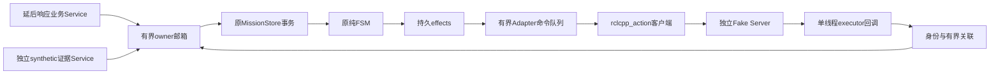

# P1-02 架构、源码取舍与模块导读

2026-10-31。设计与教学说明；实际运行结果以verification为准。共用[Action合同](../contracts/p1-action-v1.md)，不重写原Mission FSM。

来源锁定：Nav2 d5d768b7b38a05e7cfd2b6c693b786b402161bed / waypoint_follower.cpp；YASMIN abbe58d9511a79618023a530870f7d1794a829b7 / action_state.hpp；ROS2 rclcpp 7c76a00345f304c7dd145975b872f7ec66a92c9d / rclcpp_action/test/test_client.cpp，blob4371f48a0e46537a4d8bd215d8c6833b620993de。三者Apache-2.0；CMR参考后独立实现，不复制源码。Nav2/YASMIN本轮blob与既有研究一致，没有假定其最新分支或上游API等于本机二进制。

本机API最终依据：rclcpp/rclcpp_action 28.1.22的client.hpp/create_client.hpp/any_service_callback.hpp。直接使用Jazzy库；OFF模式不查找或链接这些库。最小接口包定义为MIT，未更改P0许可证元数据。

## 1. 业务服务与事务响应

**问题与位置：** 解决重复订单、网络重试和取消请求不应导致重复运输的问题。处于ROS业务入口与原Mission owner之间。

**类与调用：** MissionCommand服务；MissionNode::start_node的延后响应回调、Runtime::call、Store::submit/apply、MissionNode::poll。

**消息、线程与数据流：** 服务回调只入有界owner队列；owner提交SQLite后future就绪；wall timer检查ready后send_response。没有在executor回调内等待未完成future。

**开源取舍：** 直接使用Jazzy AnyServiceCallback的延后响应公共API；CMR接口/服务逻辑独立实现，不用通用Mission Action取代Store。

**实际运行：** 按[构建与协议指南](../guides/mission-action-tests.md)的新目录命令运行；通过`--cases`选择下列对应编号。命令经过实际执行，不直接运行旧P0 Runner。

**证据范围：** A01/A02/A16/A17。证明持久接纳、重复/冲突/BUSY、真实存储错误和过载响应；不证明任务已停车。

- **ACCEPTED什么时候返回？** Store接纳事务提交成功后，绝不是Runtime入队成功时。
- **Submit用哪个幂等键？** mission_id；Cancel/Handover的command_id作用域为该Mission，和操作及expected_version绑定。
- **为什么延后响应？** 让executor保持处理Action回调，避免等待owner和executor互相依赖。
- **服务调用超时应重发新订单吗？** 使用同mission_id重试/查询；原事务可能已经提交。
- **邮箱满会发生什么？** 明确OVERLOADED，不伪造ACCEPTED；已接纳的owner工作保留。

## 2. 薄NavigationAdapter与身份关联

**问题与位置：** 将已提交导航意图转换为一次ROS Goal，并把异步结果交回原FSM。位于Store的Port与NavigateToPose之间。

**类与调用：** NavigationAdapter::execute只在mutex下排入命令；tick在单线程executor执行客户端调用；Impl::Goal持不可变effect身份；ActionCorrelation::push归并；scope_callback在owner端限制旧操作诊断。

**消息、线程与数据流：** owner不直接调用ROS；goal_response回调绑定UUID；结果经共享关联边界先排Accepted再排Result；callback捕获weak Impl与专属Goal context，再通过有界event sink入owner。

**开源取舍：** 参考Nav2固定commit的UUID检查和YASMIN晚接受/epoch/guard；不采用cancel_all、共享全局current_goal、通用blackboard或重发循环。直接链接rclcpp_action，CMR代码独立实现。

**实际运行：** 按[构建与协议指南](../guides/mission-action-tests.md)的新目录命令运行；通过`--cases`选择下列对应编号。命令经过实际执行，不直接运行旧P0 Runner。

**证据范围：** A01/A04/A05/A08/A10/A11。A11重复/旧UUID/乱序是实际适配器共用纯边界单元注入，不宣称非法ROS线协议已制造。

- **Mission/Operation/Attempt/UUID区别？** 分别标识订单、去/返程业务操作、一次尝试、ROS Goal。
- **为什么UUID发送前可为空？** Jazzy公共async_send_goal由库生成UUID，接受handle后才能可靠关联。
- **Result先被业务处理怎么办？** 有界关联缓存先保存，Accepted事件入owner后再按身份释放Result。
- **重复和矛盾Result如何处理？** 重复不改状态；矛盾生成持久审计事件，已提交终态保持。
- **为什么不直接装Waypoint Follower？** 它没有本项目的SQLite意图、幂等和停止占槽语义。

## 3. 取消、期限和恢复

**问题与位置：** 用户取消或Server失联时阻止错误推进与重复发送。仍由原FSM决定业务结果。

**类与调用：** Store::apply Cancel→Revoke/CancelExact effect；Impl::cancel→async_cancel_goal；Adapter tick分别检查readiness/accept/execute/cancel ACK/terminal collection期限。

**消息、线程与数据流：** 晚接受会设置handle并精确取消；取消ACK只是事件，最终Goal结果和独立synthetic Stop另行入owner。steady_clock期限不受ROS clock暂停/回退影响；接受/结果回调本身也核对到期，避免wall timer调度间隙误收迟到成功。

**开源取舍：** 参考YASMIN迟到接受取消，沿用P1-01首次终止意图修复；不照搬超时后直接重试或把CANCELED等同物理停止。

**实际运行：** 按[构建与协议指南](../guides/mission-action-tests.md)的新目录命令运行；通过`--cases`选择下列对应编号。命令经过实际执行，不直接运行旧P0 Runner。

**证据范围：** A03/A06/A07/A09/A10/A12/A13/A14/A15。证明所列协议窗口保守占槽和不自动重发；无真实停车或Server跨机一致性证明。

- **Cancel ACK是不是任务结束？** 不是，目标终态与停止证据仍可能缺失。
- **Server消失意味着没执行吗？** 不意味着；已经发送的Goal保持未知，不能自动重发。
- **取消先提交后ABORTED怎么办？** 保留CANCELED业务意图，另存ABORTED导航事实。
- **为什么用单调时钟？** ROS时间能停/回退，不能维持进程期限。
- **重启为什么不恢复旧handle？** handle属于旧进程客户端；Store恢复暂停，没有足够外部证据时继续占槽。

## 4. Executor、回调与退出

**问题与位置：** 避免关闭时死锁、悬空回调和自有进程残留。位于ROS进程资源管理层。

**类与调用：** Mission主线程持SingleThreadedExecutor与Node；Runtime拥有并join唯一owner；Adapter weak Node/weak Impl；begin_shutdown、queue_shutdown、Store::active、finish、stop_callbacks。

**消息、线程与数据流：** SIGINT只设置本进程退出标记；拒新业务→提交取消/撤销→保持executor有限收尾→停止回调投递→owner排空并结算响应→销毁客户端/Node→shutdown。无detach线程。

**开源取舍：** 直接使用rclcpp executor和stop_callbacks公共API；参考上游资源归属但不额外引入Lifecycle Node。审查修复了Node→Adapter→Node强引用环；实测修复了排队Submit在SIGINT后仍接纳/发送的窗口。关闭从持久活动槽查询，先禁止新Send，再排队取消；未处理业务在owner上返回CLOSED。

**实际运行：** 按[构建与协议指南](../guides/mission-action-tests.md)的新目录命令运行；通过`--cases`选择下列对应编号。命令经过实际执行，不直接运行旧P0 Runner。

**证据范围：** A18含接受未决及重复启动/退出；13案ASan/UBSan协议检查另列。TSan运行时在空程序同样失败，不计竞态检测通过。

- **shared_ptr是否自动线程安全？** 只管理生命周期；共享可变状态仍须串行或加锁。
- **为什么不能在callback里get未就绪future？** 完成它的回调可能需要同一executor，形成自等待。
- **weak引用解决什么？** 防止回调延长已停止运行时或形成Node引用环，不代替退出顺序。
- **stop_callbacks能停车吗？** 不能，它只停止本地回调，Server Goal仍可能活动。
- **SIGKILL能正常关闭吗？** 不能；监督器记录注入和退出，依赖Store恢复暂停。

## 5. 真实Action Fake Server

**问题与位置：** 可控地产生接受/拒绝/反馈/结果/取消及晚接受，且独立记录客户端到底发了几次。

**类与调用：** Fake中的Reentrant Action callback group、MultiThreadedExecutor(3线程)、独立控制服务、wall timer、受mutex保护的Goal表。

**消息、线程与数据流：** goal callback的接受响应屏障有最大5秒上限，condition_variable等待释放mutex；控制服务在其他executor线程可释放。结果必须经控制触发，停止由另一服务fixture注入。

**开源取舍：** 参考ROS2官方test_client.cpp的真实协议验证思路，使用rclcpp_action::create_server公共API；没有复制其Fibonacci测试系统，没有引入Nav2栈。

**实际运行：** 按[构建与协议指南](../guides/mission-action-tests.md)的新目录命令运行；通过`--cases`选择下列对应编号。命令经过实际执行，不直接运行旧P0 Runner。

**证据范围：** A01/A04–A10/A12/A13。服务端日志独立记录请求UUID、取消UUID、结果和活动峰值；不会靠拒绝第二Goal掩盖客户端发送。

- **ACCEPT_AND_DEFER等于晚接受响应吗？** 不等于；本Fake使用goal callback响应屏障验证接受响应迟到。
- **为何需要多线程Fake？** 屏障占用一个Action callback时，控制服务仍要能运行。
- **成功为何不直接产生Stop？** 否则无法测试成功但停车缺证据的边界。
- **为什么审计发送请求数？** Server拒绝第二Goal也可能掩盖客户端已经发送两次的错误。
- **Fake能证明实机安全吗？** 不能，只证明本阶段协议和任务语义。

## 6. 监督器、隔离、重放和独立审计

**问题与位置：** 让故障资格、原始证据与进程清理可审计。位于协议测试设施，不取代生产FSM。

**类与调用：** run_protocol_tests.py的Case、静态check_args、动态validate_action_graph；audit_protocol.py只读检查SQLite/原始日志。

**消息、线程与数据流：** --check不导入rclpy或创建节点/目录/DB；正式模式domain72+loopback，每案唯一namespace；仅监督Popen创建的进程组；分项记录结果。

**开源取舍：** 复用P0的所有权与有界清理经验，未调用P0会启动仿真的生命周期。监督器/审计独立实现；ROS实际调度无法仅用seed固定，因此保存接收顺序与输入文件。

**实际运行：** 按[构建与协议指南](../guides/mission-action-tests.md)的新目录命令运行；通过`--cases`选择下列对应编号。命令经过实际执行，不直接运行旧P0 Runner。

**证据范围：** A17的20×200实际请求来自3个客户端；A19/A20检查额外Server、类型/配置/已有输出及正式模式拒绝；独立审计对UUID、Send/意图计数和自有PID复核。

- **domain72足够隔离吗？** 不足；还须loopback、专用名字和运行图检查。
- **NOT_EXERCISED是什么？** 故障未真正命中，不能当用例通过。
- **seed能重现全部ROS调度吗？** 不能；输入、接收顺序、屏障和版本需共同保留。
- **强制清理算正常退出吗？** 不算；正常用例清理升级会使harness失败，计划SIGKILL另记故障注入。
- **独立审计看什么？** Server收到的UUID、Native Send调用、SQLite意图/接受记录、Cancel关联、活动峰值和原进程身份。

