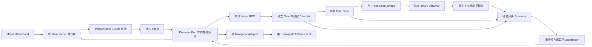

# P1-03 实现设计与所有权

工程权威：本仓库 Mission v1、p1-execution-v1、p1-stop-evidence-v1。实现和验证层级见最终验收报告，不用本设计文档代替运行证明。

## 实际职责与调用图

Mission 的 SQLite 在 Runtime owner 线程内访问；ROS 回调不读写业务库。ExecutionPort::execute 只入队；tick/RPC 回调在 Mission ROS Executor 中处理。ExecutionPort::evidence_current 用不可变快照和原子 shared_ptr 给 owner 作新鲜度复核。

Gate 和 Observer 各是独立 OS 进程、单线程 Executor、wall tick。Gate 所有控制/候选/发布在同一串行边界；不创建独立发布线程。Observer 正常关闭用自有信号标志，先停止 Executor 再销毁对象和 shutdown，避免默认 rclcpp 信号在 GID 查询回调中使 context 提前失效。SIGKILL 不经过这些关闭流程。

## 事务与外部副作用

1. submit 的任务与活动槽事务提交后，才回应 ACCEPTED。
2. Prepare 生成逻辑 Send 意图，不直接发 Action。
3. inspect 返回 Gate context，owner 事务绑定并产生 BeginLease 意图。
4. challenge/Begin 授权后，owner 事务记录绑定并产生 SendAuthorized 意图。
5. Port 检查匹配的新鲜 GateState 与保守剩余期限，才交原适配器发送一次。
6. 每次 RenewLease 都来自新的 owner 事务；Port/Executor/队列有故障时不续租。
7. Revoke 与 Action Cancel 独立。已撤销、Goal 终态、D 窗口三者齐备后，owner 再事务释放活动槽。

请求发送时间加响应 remaining_ms 是保守的本进程期限，避免将网络等待时间算成新的有效期。服务超时移除 pending future，未知 Begin 不能直接重试成新的 Goal；观察匹配 GateState 后撤销，超时/进程恢复仍保留未知槽位。

数据库不能写入时，业务成功不会被虚构。原 Store 的 emergency revoke/cancel 是失效保护，明确记录为 NOT persisted 的应急动作及 stderr 原始证据，不宣称它是正常已提交业务效果。真实 Gate 仍靠独立单调租约兜底。

## 资源边界

| 资源 | 边界与策略 |
|---|---|
| Port owner→ROS 命令 | 32；溢出锁存 fault，拒绝新发送/续租，允许应急撤销/精确取消 |
| Port ROS→owner 关键事件 | 64；过载锁存，当前 context 转撤销，不能靠独立续租保活 |
| Gate RPC pending | ≤8，250ms 期限；移除未完成请求，不无限保留 future |
| Port context / effect 历史 | ≤64 / 4096；容量耗尽保守失败，需按恢复策略处理，不自动清历史复活 |
| Gate challenge | 最多1个，100ms，本地 steady；单次消费 |
| Gate Begin 幂等历史 | 64；容量满锁存，非LRU驱逐 |
| Gate 候选缓存 | 1条 pending + 1条合格候选；所有失效清空 |
| StopWindow | ≤1024样本；滚动3s，跨 generation/clock/接收缺口重建 |
| Native进程关闭 | Gate 禁止后继续周期零3500ms；其他线程/Executor先停后销毁；测试监督器有界等候、强制升级记失败 |

上下文上限与日志是审计/资源边界，不是无限长期配送调度能力。持续运行、FIFO、多订单交接返航、恢复界面留给后续阶段。

## 受控图与身份

ExecutionIdentity 的 owner_epoch 对应 Mission process epoch；其余字段 run_id、gate_epoch、mission_id、operation_id、attempt_id。Lease 服务还带 request_id、request_seq、lease_id、challenge 和 old_goal_resolved。

TwistStamped 没有 Goal UUID；关联依赖唯一 Goal sender、旧 Goal 已解析、停止窗口、缓存清空和授权后的来源 stamp。GID/节点名/namespace/type 用于受控环境防误接，不是对恶意参与者的安全认证。图发现/100ms周期监控有延迟，不能声称瞬时防旁路。

Observer 核对 state/final/clock/odom 的唯一发布者 GID，里程计必须 odom 坐标系、base_link/base_footprint 子坐标系。Mission 再核对 StopReport 发布者、完整身份、clock/generation、来源及接收新鲜度；不能把 STOPPED 字符串直接当事实。

## 开源来源与独立实现

twist_mux 的仲裁/锁/超时用于设计参考；不引入其框架。安装的 Nav2 Smoother/Collision Monitor 直接运行，保留源时间，不用其 stop_pub_timeout 冒充持续 watchdog。Nav2 Jazzy 的 TimedBehavior 每个插件创建一个速度发布者，运行图按五个插件加一个 Controller 精确检查。

ros_gz_bridge 的独立 ROS/GZ 端点直接用于派生配置。DiffDrive 8.15.0 从关节位置推算 odom，无已验证命令 timeout；因此 Gate 自身失效/下游断链仅在 sink 中做保持最后值负例，保护结论为 UNSUPPORTED。

源码、commit、许可证与复制/适配分类见 THIRD_PARTY.md。教学问题、可复制命令见 docs/guides/execution-gate.md。

正式速度链已经收敛为CM直连Gate；candidate_relay不在正式路径。Gate/Observer use_sim_time=false，只消费经过校验的Clock数据并用steady/wall驱动，显式关闭隐藏时钟线程。G05通过本轮CM进程短暂停流后恢复验证不自动续航。独立到达验收0.25m/0.25rad，外层Goal checker与DWB内部XY窗口都收紧为0.18m，防止只旋转的判据冲突。
