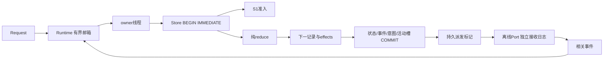

# P1-01 离线设计与测试矩阵（2026-10-31）

范围：C++17纯FSM、系统SQLite、单写者、离线Port；不是ROS协议或停车性能验证。S1保持原实现。

## 调用关系与资源

`Runtime::call`返回future；入队满抛OVERLOADED，关闭抛CLOSED；已入队工作在关闭时排空。只能owner线程调用Store，数据库事务与Port调用分离。Store锁来自规范化DB路径，拒绝符号链接及DB硬链接；这是本机路径合同，不是分布式锁。

`reduce`返回Decision；无I/O。终态稳定，Cancel/成功按Store处理顺序线性化。Stop只接收synthetic测试证据，要求相关epoch和推进观测范围、有效期；此模块不分析实际odom，也不声称停车。未决Goal或停止缺失时Resolve不释放槽。暂停任务的旧Send不能派发。

表：missions存版本化规范Record，manager单行持活动槽，events有全局序号及每Mission唯一事件ID、身份和转换后记录，operations保存稳定effect ID和INTENT/DISPATCHING/SENT/UNCERTAIN。Record采用版本化quoted文本编码，拒绝非法格式；不是面向外部的ROS序列化协议。状态/事件/意图/槽统一提交。WAL/FULL/foreign_keys读回验证，busy上限100ms。数据库错误锁存业务故障，紧急Revoke/Cancel作为无法保证持久化的保守出口，stderr明确标识。

## 测试入口

| CTest组 | 反例与oracle |
|---|---|
| 8项mission_admission_* | 原S1，校验/语义相等/冲突/优先级/不变性 |
| mission_state_timelines | 手写正常去返程、取消两顺序/晚接受、旧身份、目标/停止分别缺失、Stop时效/epoch、交接版本/超时、返航失败、重试预算、终态 |
| mission_store_contract | 真实SQLite约束、RAISE(ABORT)回滚、只读、busy、损坏/未知版本、重开、第二所有者、邮箱满/关闭、旧Send资格 |
| mission_crash_windows | Python监督真实C++Runtime子进程，管道屏障、SIGKILL、独立fsync接收文件；八窗口各保存DB和恢复结果，另尝试第二进程打开验证排他 |
| mission_interleaving | 条件变量同时提交不同ID/相同ID/冲突内容；20固定种子×200事件，每步SQL查询槽和意图，接收端effect ID去重、终态比较；保存操作序列与状态轨迹 |

八窗口：submit-before、submit-after、intent-after、send-after、accept-after、cancel-after、terminal-before、terminal-after。未命中屏障会失败，不记通过。记录中的SIGKILL只作用于Popen产生的自有进程；不证明断电或ROS结果。

随机生成器版本：本轮源文件指纹。事件文件保存操作码，具体事件字段由固定版本生成器和前一持久状态确定；trace保存逐步完整状态编码，可使用EVENT_FILE重放。随机测试不替代确定性反例，更不是稀有故障概率证明。未运行TSan，ASan/UBSan不证明无数据竞争。

## 第三方边界

S2复读YASMIN固定commit的add_state合法性检查，参考显式事件/状态设计；不采用blackboard/框架执行器。S3调用系统SQLite C API，参考官方BEGIN IMMEDIATE/COMMIT、prepare_v2/bind/step文档。S4参考已研究的持久意图和不确定外部发送边界，独立实现屏障；S5使用标准C++17线程/条件变量，测试oracle独立查询DB/接收文件；S6沿用现有CMake/CTest并独立实现离线CLI。没有复制第三方FSM/Action实现，没有引入YASMIN/Nav2依赖。

各阶段原始日志在evidence/env/p1-01-complete-k_1031po；实际最终数量和局限以verification报告为准。

## I1–I10证据定位（最终补充）

| 不变量 | 生产边界 | 独立观察/确定性案例 |
|---|---|---|
| I1 单活动任务 | manager单行槽与owner事务 | interleaving每步SQL count、三类同时准入、runtime_races未决时新ID BUSY |
| I2 单未决/活动导航 | Prepare/Retry状态资格、派发Operation/Attempt/phase检查 | 独立Sink active_attempts集合，每次Send不能使活动数超过1；合法终态事件后清除对应attempt；Store旧Send回归 |
| I3 幂等 | 请求字段相等、events/effect唯一键 | 同ID并发、DB操作ID唯一查询、独立接收端禁止同effect再次执行 |
| I4 终态稳定 | reducer终态早返回 | 随机前后encode比较、已完成后Cancel确定性用例 |
| I5 未决占槽 | Resolve要求目标+撤销+新鲜停止 | runtime_races补停止前新ID BUSY；随机记录目标/撤销/停止不满足时SQL检查仍占槽；S2分别缺失反例 |
| I6 重启不重发 | 恢复PAUSED/UNCERTAIN、旧意图状态改Unknown | 八个独立子进程窗口比接收文件前后字节；随机重启前后Send计数 |
| I7 提交失败不Send | Tx rollback、fault latch | 真实RAISE(ABORT)/busy/readonly；重开检查任务不存在，事务前无Port派发 |
| I8 旧身份隔离 | mission/epoch/attempt/uuid核对 | 随机旧owner前后Record一致、S2旧epoch/UUID/attempt，旧停止epoch |
| I9 有限恢复 | 一次重试、固定总deadline | 随机retries<=1/deadline前后不变，S2第二次恢复拒绝 |
| I10 业务事实分开 | Arrival、Stop、Handover、Result分事件 | 随机Completed/WaitHandover必备事实独立断言；S2交接超时/错误版本/返航失败保留handed_over |

oracle读取SQLite和接收文件，不调用生产reduce推导期望；Record格式解析本身仍复用decode，因此不是第二套独立序列化验证器。I1–I10是有限用例证据映射，不是穷举证明。随机无失败时没有可最小化的失败样本；若未来失败，先保存原始events/trace与版本，再手工缩为确定性回归，不要求为尚未发生失败引入通用缩减框架。

新增mission_runtime_races：两个生产者同时就绪后，用条件变量控制Cancel/Succeeded两种入队顺序；确认旧任务停止未决时新任务BUSY；20轮关闭/提交竞争要求future终结、ACK与重开DB存在性一致。不是用sleep猜顺序。
