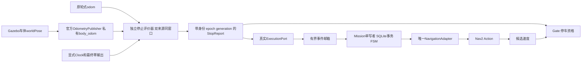

> **当前验收状态（2026-11-03）：G02–G06自动工程验收通过；G01本人交接未执行，P1-04仍为PARTIAL。** Oracle辅助停车资格已获本人明确授权，仅限P1仿真，不进入Nav2定位/规划。最终报告见`docs/verification/p1-04-stopfix-ds6qdezr.md`；本人操作见`docs/guides/p1-04-human-handover.md`。

# P1-04 配送代码学习与复现

本文对应 Ubuntu /home/robot/commercial_mobile_robot。当前验收以 docs/verification/p1-04-stopfix-ds6qdezr.md 为准；代码、编译、Fake/sink 协议、真实 Gazebo、用户人工交接是不同层次。本文中的运行命令不会由文档自动执行。所有运行必须使用新目录和新 run_id；不重用历史 DB。

## 先建立整体认识

配送请求通过 DeliveryCommand 服务进入 MissionNode，回调只把请求交给 Runtime 邮箱。Runtime 的唯一 owner 线程调用 Store，在 BEGIN IMMEDIATE 事务中登记订单、更新原 Mission FSM 并写 effect。事务提交后才 dispatch。NavigationAdapter 负责真实 Action；ExecutionPort 负责真实 Gate 租约，两者都把回调重新投递给 owner。

运行关系：

原 Runner → 监督 worker/Gazebo/Bridge/Nav2/Gate/Observer/Mission/recorder。
worker → 启动协调、只读观测、业务服务请求；不创建 ActionClient。
Mission owner → SQLite + 原 FSM → ExecutionPort → Gate。
获准 effect → NavigationAdapter → NavigateToPose → Nav2。
Nav2 → smoother → Collision Monitor → Gate → 私有 Bridge/DiffDrive。
Observer/DeliveryMonitor → 独立停止/到达事件 → owner → WAIT_HANDOVER/COMPLETED。

SQLite 和外部 Action 不存在跨进程原子事务。DISPATCHING 后崩溃可能留下已发送但未获知的 Goal；重启必须保留 PAUSED/UNCERTAIN，不自动重发。Gate 的独立 steady watchdog 是 owner 失效后的有限保护；Gate 自身死亡或 Bridge 断链仍没有已证明的下游失效保护。

## 1. 请求准入、站点与到达

解决问题：商用订单给的是站点名称，不能直接相信随意坐标；Action SUCCEEDED 不能单独证明到站。主要代码：

- src/cmr_mission/include/cmr_mission/delivery.hpp
- src/cmr_mission/src/delivery.cpp：StationCatalog、checked_pose、file_sha256、ArrivalWindow。
- src/cmr_mission/src/delivery_monitor.cpp：DeliveryMonitor::tick、sender、graph。

StationCatalog 用严格 JSON schema、重复键拒绝、有限数与单位平面四元数、map frame、坐标范围及资源 SHA256 拒绝错误输入。freeze() 固化去程/返程坐标、地图/站点版本和 BT 内容指纹。系统 nav2_map_server::loadMapFromYaml 生成实际 OccupancyGrid；CMR 只对安装组件输出做 hash，不重新写 PGM 转换。

DeliveryMonitor 在同一个 ROS Executor 内接收 /map、/amcl_pose、/scan、/odom、/clock、GateState，并使用 spin_thread=false 的 TF Listener；向 owner 发布不可变健康快照。它验证发布者 GID/节点/命名空间，检查实际地图栅格、扫描/里程计新鲜度、TF 和时钟连续性。steady 与 ROS source time 各自使用，不能跨时钟直接相减。

ArrivalWindow 要求当前 attempt、clock epoch、Action 终态后的连续至少 1 秒/5 样本，源/接收间隙、新鲜度、.25m/.25rad 误差及与 D 停止窗重叠。角度使用 atan2(sin Δ, cos Δ)。定位跳变会锁存，TF 缺失不能沿用缓存判成功。

必须理解：

1. 为什么地图名称不够？同名地图可换内容，必须核对实际栅格和文件指纹。
2. 为什么不能挑距离目标最近的一帧？那会选择性忽略随后偏离、跳变和旧数据。
3. 为什么 TF 最新时间不总是 wall now？TF 属于显式 ROS source clock；watchdog 属于 steady。
4. 为什么过期证据不能补写成功？它不能证明事务提交时仍满足到达/停止资格。
5. 导航成功、到达、停止、交接有什么区别？分别是协议终态、定位几何事实、运动反馈事实、业务人工事实。

## 2. 原 Mission FSM 与持久化 FIFO

主要代码：

- src/cmr_mission/src/mission.cpp：reduce、encode、decode。
- src/cmr_mission/src/mission_store.cpp：register_delivery、promote、cancel_delivery、confirm_handover、schedule、dispatch。
- src/cmr_mission/include/cmr_mission/mission_runtime.hpp：有界 call 邮箱、唯一 owner。

新的 WAITING 是 registrations 队列状态，不是第二个活动 Mission。默认 capacity=4 不含活动任务；capacity=0 保留 BUSY。相同 ID/相同完整内容返回原登记，冲突内容拒绝；幂等检查先于满队列检查。queue_seq 持久单调，空活动槽但已有队列时，新订单也必须排队。promote 在同一事务中重检队首冻结输入和健康、占活动槽并改变登记，不能先从内存队列弹出再写 DB。

正常完成后可继续 FIFO；取消、失败、重启和未知外部状态后默认暂停。resume_schedule 不表示消除旧 Goal；未决活动任务仍拒绝恢复调度。新 schema2 使用新 DB；历史 schema1 不自动迁移。配送 Record format3 与旧 format1 兼容读取，早期本阶段 format2 也有明确兼容路径。

必须理解：

1. 为什么单写者仍需要 SQLite 事务？多表活动槽、登记、事件、effect 仍必须一起提交，崩溃可能发生于任意指令。
2. 邮箱入队成功等于接单成功吗？不等；只有登记事务 COMMIT 后才是 ACCEPTED/QUEUED。
3. 为什么队列等待者不创建 Mission？等待还没获活动槽，不能提前生成导航/授权身份。
4. 同时取消和提升谁赢？owner 接收顺序经事务线性化；先提升则转为活动取消，先取消则不提升。
5. 为什么旧 DB 不自动批量升级？历史 evidence 是原始证据，迁移会改变事实载体；本阶段用独立新 DB。

## 3. Action、租约与有界恢复

主要代码：

- src/cmr_mission/src/nav2_adapter.cpp：NavigationAdapter，冻结目标 payload、UUID、接受/结果/取消。
- src/cmr_mission/src/execution_port.cpp：ExecutionPort，inspect/challenge/begin/renew/revoke/reset。
- src/cmr_execution/include/cmr_execution/gate.hpp：授权纯核。
- src/cmr_execution/src/stop_observer.cpp：独立窗口观察。

Prepare 持久化 effect；Port 先 inspect Gate 并把 context 事件交回 owner。BeginLease 和 SendAuthorized 都必须由 owner 提交后执行。租约不能由独立线程无限续期。新去程/返程/重试有新的 Operation/Attempt/UUID/lease；上段先 Reset，且 Reset 不会自动授权。早取消仍取得真实 Gate context 后只 Revoke，不能为了收尾发 Begin。

正式模式只接受 non-synthetic StopReport；隔离 Fake/sink 使用明确 synthetic 报告。取消应答只表示收到取消请求，不证明 Goal 已终止或机器人已静止。只在 Goal 终态、A 授权撤销、D 独立停止、当前证据有效时解析活动槽。

研究 Nav2 固定 commit d5d768b7b38a05e7cfd2b6c693b786b402161bed 的 RecoveryNode、WaitAction、NavigateToPoseNavigator、BtActionNode 和真实恢复测试后，P1 BT 仅保留一次 clear local/global + Wait 2s，无恢复 Spin/BackUp。Mission 仅对白名单 NAV_ABORTED、旧 Goal 终止/停止/健康/剩余预算合格时，允许全任务共享一次新增 attempt；普通返航不消耗故障重试，任务总期限不重置。

必须理解：

1. 为什么 UUID 和 mission_id 不能互换？一个订单可有去程、返程及一次重试，每个外部动作身份不同。
2. 为什么取消 ACK 不放槽？服务器可能仍在执行，成功也可能与取消竞争。
3. 为什么新租约不能复用旧缓存？旧候选可能属于上个任务；Begin 要重新满足新鲜输入。
4. DB 与 Action 间的窗口如何处理？先写意图，再发送；不确定则锁住恢复，而不是猜测未发送。
5. 为什么不用完整 Waypoint Follower/YASMIN 替代 Mission？它们不能直接满足本仓库事务、身份、队列及独立租约合同；只借鉴成熟设计。

## 4. 人工交接

入口是 src/cmr_interfaces/srv/DeliveryCommand.srv 和 tools/mission/delivery_command.py。WAIT_HANDOVER 进入版本产生 handover_id 与 handover_entry_version；后台停止证据续新不会改这个入口 token。确认时 owner 再检查 A/D/到达、健康与单调 deadline；now==deadline 已过期，提交前也检查。事务同时记录 handed_over 与唯一返程意图。相同 command_id/内容返回原决定；换 source/token 的冲突请求不能复用。

G01 必须用户本人执行命令。Runner 到达时写 runtime/human-handover-required.json 并输出准确的当前 token 命令；AI 不会调用 source=human。G02/G05 自动交接标记 synthetic，真实运动与 synthetic 业务确认分列。超时不确认、不返航，按失败/停止规则收尾。返航失败不抹除 handed_over。

必须理解：

1. token 为什么不直接取最新 state_version？后台 Stop/Arrival 会更新状态版本，交接入口身份应稳定。
2. 响应丢失能重试吗？使用同一个 command_id 和相同内容，返回已持久化决定，不发第二个 Goal。
3. 取消与交接同时到达怎么办？按 owner 事务顺序；已确认事实保留，未确认先取消则拒绝。
4. 交接提交前崩溃会怎样？事务回滚，不能凭内存状态补发返航。
5. 提交后崩溃会怎样？保留 handed_over/return intent，重启暂停且不自动重发，重复确认仍可查询原决定。

## 5. 原 Runner 的 Mission 模式

主入口 tools/run_trial.py → tools/runner/trial.py；业务编排 tools/delivery/session.py，不另建仿真生命周期管理器。版本4 profile 必须显式 --mission，旧 P0 默认模式保持原接口。prepare_delivery_trials.py 离线生成派生输入；--check 只读验证，不建 DB、不建 run、不启动进程。

worker 的 tools/delivery/worker_policy.py 在分派前拒绝第二 Goal 入口。mission_motion_ready 必须观测匹配 UUID 的 ACTIVE 和新鲜里程计实际位移/速度，故障注入不靠固定 sleep。G06 仅在原 Supervisor 明确声明拥有的 Mission 失效后终止该 PID；PID/start_ticks/token 必须匹配，不能终止其他 Gate/Bridge。测试注入 SIGKILL 与清理时被迫升级分别记录，后者仍判 cleanup 失败。

示例准备与检查（user_r1需使用本轮尚未用过的小写后缀，不能覆盖已有目录）：

~~~bash
cd /home/robot/commercial_mobile_robot
source evidence/env/p1-04-stopfix-ds6qdezr/ros-install/setup.bash
python3 -B tools/run_trial.py --help
python3 -B tools/mission/prepare_delivery_trials.py \
  --base-profile experiments/runner_profile.yaml \
  --install-prefix "$PWD/evidence/env/p1-04-stopfix-ds6qdezr/ros-install" \
  --output-dir "$PWD/evidence/env/p104-operator-inputs-user_r1" --suffix user_r1
python3 -B tools/run_trial.py --mission --check \
  --scenario evidence/env/p104-operator-inputs-user_r1/G01/scenario.json \
  --profile evidence/env/p104-operator-inputs-user_r1/G01/profile.json \
  --method mppi --run-id p104_20261103_g01_user_r1
~~~

实际启动同一命令移除 --check。不能在已有 Gazebo 运行时再启动。人工确认应在另一个终端 source 同一安装环境，并设置 profile 规定的 Domain71/FastDDS；运行 runtime/human-handover-required.json 提供的确切命令，不替换 token，不重用别轮 run_id。

必须理解：

1. 谁创建子进程？只有原 Runner 的 ProcessSupervisor，worker 不创建生命周期。
2. 谁发 Goal？Mission 的 NavigationAdapter；worker 连 ActionClient 都不创建。
3. 出现已有 Gazebo 怎么办？拒绝第二服务器，报告归属，不清理未知进程。
4. SIGKILL 故障可当正常退出吗？只有预声明的、已资格确认的 G06 Mission 注入；清理升级不能因此变绿。
5. --check 能建立服务客户端吗？不能；其数据路径无 ROS 导入/节点/DB 创建。

## 6. 构建、业务命令、证据审计

独立 OFF 构建示例：

~~~bash
cmake -S src/cmr_mission -B evidence/env/p104-local-UNIQUE/mission \
  -DCMR_MISSION_BUILD_ROS=OFF -DCMAKE_BUILD_TYPE=Release
cmake --build evidence/env/p104-local-UNIQUE/mission -j2
ctest --test-dir evidence/env/p104-local-UNIQUE/mission --output-on-failure
~~~

ROS 构建必须在 source /opt/ros/jazzy/setup.bash 后，colcon --base-paths src/cmr_core src/cmr_interfaces src/cmr_execution src/cmr_mission，指定独立 --log-base、--build-base、--install-base，CMR_MISSION_BUILD_ROS=ON、CMR_EXECUTION_BUILD_ROS=ON。实际完整命令保存在本轮证据根 ros-build-command.json、release-commands.json、mission-off-final-commands.json。ASan/UBSan 原失败与逐 seed 重跑也分别保存，不能只摘绿色输出。

服务命令示例。SERVICE 必须替换成当前 run 的 /cmr_execution/<run_id>/delivery；这些命令本身不创建导航 ActionClient。G01 的 handover 命令只允许本人执行。

~~~bash
export ROS_DOMAIN_ID=71 RMW_IMPLEMENTATION=rmw_fastrtps_cpp
SERVICE=/cmr_execution/REPLACE_CURRENT_RUN_ID/delivery
python3 -B tools/mission/delivery_command.py --service "$SERVICE" queue
python3 -B tools/mission/delivery_command.py --service "$SERVICE" query --mission-id CURRENT_MISSION
python3 -B tools/mission/delivery_command.py --service "$SERVICE" submit \
  --mission-id NEW_MISSION --command-id submit_NEW_MISSION \
  --delivery-station delivery --return-station home \
  --map-version tb3map_2a284eba0a3a --station-version p104_stations_v1 \
  --created-at-unix-ms 1
python3 -B tools/mission/delivery_command.py --service "$SERVICE" cancel \
  --mission-id CURRENT_MISSION --command-id cancel_CURRENT_MISSION
python3 -B tools/mission/delivery_command.py --service "$SERVICE" pause-schedule
python3 -B tools/mission/delivery_command.py --service "$SERVICE" resume-schedule
~~~

created_at_unix_ms 示例1只是显式测试元数据，不能当真实下单时间。正式接单保留首次输出中的原值；提交响应未知时不能更换 Mission ID 或请求内容猜测重试。恢复调度只在没有未决活动任务及健康条件合格时允许；不提供自动重发不确定 Goal 的命令。

闭合数据库查看与审计（owner必须退出，非空WAL/journal拒绝；不删除日志来通过检查）：

~~~bash
python3 -B - <<'PYSQL'
from tools.delivery.records import read_database
rows = read_database('/home/robot/commercial_mobile_robot/evidence/missions/CURRENT_RUN/runtime/mission.db')
print(rows['registrations'])
print(rows['operations'])
PYSQL
python3 -B tools/mission/audit_delivery.py \
  --session evidence/missions/CURRENT_RUN --output evidence/env/UNIQUE-audit.json
python3 -B tools/mission/summarize_delivery.py \
  --sessions evidence/missions/RUN_A evidence/missions/RUN_B \
  --output evidence/env/UNIQUE-summary.json
~~~

read_database先持有已有owner共享锁并确认无待处理日志，再用immutable只读连接并显式关闭。普通SQLite mode=ro仍可能参与WAL/SHM生命周期，不能据此保证历史证据目录逐字节不变。

records.py 从 SQLite 重新推导业务事实、队列、最大活动槽/未决 Goal、handed_over 与版本关系。inspect_delivery_bag.py 只读闭合 MCAP，重建 TF、实际 Action UUID/终态、源时钟、地图栅格、每段到达与 A/B/D，并与独立 worker steady 接收记录、Gazebo body pose交叉检查。不能把 bag 的仿真时间戳当 wall 延迟。结果哈希引用不可逃出目录，缺文件、错 hash、空引用或坏数据库不得通过。summarize_delivery 重新审计每个会话，首次订单数量和 Submit 调用次数分开。

A=禁止新的非零，B=最终持续零，C=下游确认边界，D=独立运动反馈静止；当前 C 仍 CONSUMER_ACK_UNKNOWN，collision 仍 null，不声称硬件安全。业务 COMPLETED 不抹去 harness/cleanup 失败；所有失败样本保留。

必须理解：

1. 编译通过证明什么？仅构建/API 兼容，不证明线程退出、运动或停止。
2. 为什么需要离线独立审计？在线实现可能有相同错误；用原始测量重新计算能发现错误成功声明。
3. hash 能证明机器人停止吗？不能；hash 仅证明文件内容身份，停止需要时序和运动数据。
4. 为什么不覆盖同一个 result？多个 Mission/去返程/重试必须各保留稳定身份与事件来源。
5. 什么时候能宣布 P1-04 全通过？全部必要离线、协议、G01–G06、本人交接和记录/清理门槛都通过；缺一则 PARTIAL。

## 推荐源码阅读顺序

DeliveryCommand.srv → mission_node.cpp 的 start_delivery_api → StationCatalog::freeze → Runtime::call → Store::register_delivery / promote → reduce → Store::dispatch → ExecutionPort → NavigationAdapter → Gate / StopWindow → DeliveryMonitor / ArrivalWindow → confirm_handover → 新返程 Operation → Resolve → records.py / inspect_delivery_bag.py → 原 Runner 与 DeliverySession。

读每个 effect 时先找“谁持久化、谁执行、谁回传、崩溃会留下什么”，再读回调细节。不要把上游组件功能、CMR 业务决策和测试驱动混成同一个状态机。

## 本轮反例应掌握的五个问题

1. **轮式里程计速度为零是否代表车体已静止？** 不一定。G03 实际窗口中，轮式记录通过，但独立车体差分速度 0.01086448 m/s，超过冻结的 0.01 m/s。测量来源与物理对象必须分清。
2. **为什么撤销很快仍不能宣布取消安全完成？** A 层本轮约 4.25 ms 观测到禁止；D 层仍被反例否定。授权变化、零命令、目标终态和物理静止是四件事。
3. **离线验证能否另挑稍后的合格停车窗口？** 不能替换 Mission 当时依赖的窗口。应从 APPLIED Stop 到 Resolve，绑定 operation/attempt/UUID、owner/Gate/clock epoch、generation 和精确 from/to；当前 oracle 已实现此关联。
4. **为什么没有直接把三秒改成更长？** 任意加等待不能建立可信反馈来源，更不能追认已有失败。需要先修复停止证据链，再保留原阈值用新回合验证。
5. **SQLite mode=ro 是否绝对不碰证据目录？** 否。WAL 模式可能仍涉及 SHM/WAL 生命周期。本轮闭合库 reader 验证 owner 已退出、无待处理 WAL/journal，再用 immutable=1 并显式关闭；活动库或非空日志拒绝，不丢弃 WAL 后读取主文件。

## 停止证据修复：轮式运动与车体运动是两个来源

2026-11-03继续执行。新源码新增`cmr::execution::BodyWindow`（stop.hpp）；Observer保留原StopWindow，仿真时再用BodyWindow包围同一精确from/to。模型派生配置添加Gazebo官方OdometryPublisher（worldPose），Bridge将`<run>/body_odom`单向转为ROS私有Odometry，worker只读保存接收steady时间。该数据不进入Nav2的/tf、/odom或定位。Gate和正式ExecutionPort要求`WINDOW_PROVEN_BODY_POSE`才采纳静止；缺失仍占槽。

调用关系：Gazebo物理worldPose → 已安装OdometryPublisher → 独立私有Bridge输入 → Observer.body_sub → BodyWindow.add/evaluate → StopReport → Gate.stationary以及真实ExecutionPort → owner事件邮箱 → SQLite Stop事件 → FSM Resolve。原轮式StopWindow先合格，BodyWindow才检查同一窗口；所有原阈值冻结。MCAP oracle独立重算差分速度并核对Gazebo另一条world-pose原始记录，worker另核对steady接收间隙。

核心概念：轮转不等于车体平移；发布零不等于停稳；窗口时间属于source clock，接收新鲜度属于steady；跨源回调顺序不从bag到达行号推断；反馈未知时不能释放活动槽。

五问：
1. 为什么不用插件twist直接判停？它包含滚动平均，可能掩盖短暂运动，所以同时逐对计算原始位姿速度。
2. 为什么要包围轮式窗口？两个不重叠时段的静止不能合成同一事实，边界前一采样也保留以检查滑行。
3. sink_body是什么？仅domain72、/cmr_test命名空间，输出仍synthetic=true，专门验证body必需/停流分支；正式仿真无法用它替换真实反馈。
4. 真值是否驱动导航？没有。它只为停止观察提供独立只读反馈，导航继续使用原轮式odom/AMCL/TF。
5. 修复是否证明实车安全？没有。它只修复本Gazebo受控链的反馈来源，C层ACK、Gate自身失效和实车制动限制继续保留。

本轮新证据根`/home/robot/commercial_mobile_robot/evidence/env/p1-04-stopfix-ds6qdezr`，真实结果以新验收报告为准。用户当前无法本人确认G01，先执行其余验证；不自动发human确认。

本轮获准的数据流（仅P1仿真Oracle辅助停车资格）：

body_odom的实际订阅者白名单仅独立停止评价器、只读worker和recorder。真实运行图若发现AMCL、Planner、Controller、Mission等直接订阅，拒绝进入任务。相关验证由`validate_body_feedback_graph`与运行图原始端点清单共同证明；名称不是安全认证或恶意节点隔离。

## 当前控制组合：p104-mppi-short-leg-v4

当前MPPI路径为本机Nav2 1.3.13官方RotationShimController→primary MPPI：在位置容差内处理终点转向，初始转向仅新目标启用；GoalCritic权重20，primary GoalAngleCritic关闭。原位置/朝向、停止、速度、0.5m/10s进展和期限条件不变。DWB保持原派生配置。

此前v1/v2/v3的实际无进展失败均保留，分析见验证报告和集成设计。只有v4的新实际回合用于最终MPPI完整配送/队列结论。源码研究、许可和直接复用范围见THIRD_PARTY.md；manifest、实际参数及源码快照如实标明组合，不冒充裸MPPI比较。

## 最终短段控制组合：五个必须理解的问题

1. **是谁发送NavigateToPose？** 仍只有真实Mission的NavigationAdapter。Rotation Shim不是另一个Goal发送者，它在Nav2 ControllerServer内部实现同一个Controller接口。
2. **控制调用如何分工？** ControllerServer调用Shim.computeVelocityCommands；新Goal必要时先原地对齐，再调用primary MPPI跟踪；进入原位置容差后，Shim负责终点朝向。ControllerServer给最终候选设置base frame与计算时间，原Smoother/CollisionMonitor/Gate继续处理。
3. **为什么不能只把进展检测放宽？** 本轮保留0.5m/10s原判据、全部速度和到达/停止门槛。v2/v3失败也保留。v4改变控制代价（GoalCritic权重20）和仅新目标起始对齐选项，以改善短段推进；实际是否合格仍由原判据和独立原始记录决定。不能从单轮成功推断任意地图上的普遍鲁棒性。
4. **哪些代码属于第三方？** Shim和MPPI均为Nav2已安装Apache-2.0组件；CMR独立实现任务FSM、SQLite事务、队列和Gate/停止判定。本轮只适配派生配置、接口及验证，没有复制一套Nav2或引入新任务框架。
5. **如何独立核验组合？** 查看会话runtime/all-parameters.json的FollowPath.plugin、primary_controller、rotate_to_goal_heading、rotate_to_heading_once、GoalCritic.cost_weight和GoalAngleCritic.enabled，再与mission-manifest.controller及冻结profile比较。运行命令和本人G01流程见p1-04-human-handover.md；audit_delivery同时复算实际Goal、到达、停稳和进程收尾。

当前最高有效P1仿真例外见docs/adr/p1-oracle-stop-20261103.md，仅允许Oracle辅助停车资格，不进入Nav2定位/规划输入。完整验收仍需G01本人实际交接，AI没有代操作。

## 录包行序不是跨话题因果序

独立验证器通过APPLIED Stop→Resolve绑定实际消费报告的身份、generation和精确source窗口；不从后续挑选停车样本。GateState使用自带ros_ns，独立worker使用同进程steady接收间隔，body位姿与wheel使用source stamp。不同DDS writer的消息到达录包器先后不能证明谁先发生；同一时刻之后的Reset也不能回写过去的状态。r10因此暴露的验证器失败保留，源码修复后用r11新冷启动回合重测，旧结果不改写。
