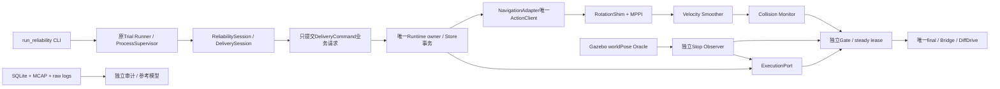

# P1-05 可靠性验证与学习说明

范围：Ubuntu /home/robot/commercial_mobile_robot，本轮evidence/env/p1-05-dev-b1sg_5gd。工程实施中，最终结果以verification为准。G01D采用本人批准的AI代理交接source=synthetic；原human G01超时失败保留，不能称为本人已验。Oracle辅助停车，不是sensor_only_E2或实车。

## 调用与所有权



Driver不直接发Goal、不续租、不创建Gazebo进程；原Runner生命周期保持。FSM决定业务，Action追踪外部执行事实，Gate独立控制有限授权，停车评价器要求轮式和车体同窗。

## 模块与配送问题

1. `tools/reliability/candidate.py`: `source_manifest/source_id/freeze`冻结真实未提交源码、patch、依赖和ELF。解决“交付的版本与测试版本不同”。快照含未跟踪合法源码，无Git提交动作。
2. `tools/reliability/plan.py`: `policy/prepare/validate`只允许审查过的profile4派生，提交计划、期限、容量和资源全部先冻结。订单身份与候选身份、session身份分开。Gate64个Begin历史限制使本轮一小时计划20单/60个最大attempt额度，不能重启清历史。
3. `tools/reliability/session.py`: `ReliabilitySession.execute`在原Runner的READY、录制和初始停止后开始steady t0；60秒机会、固定订单、资格synthetic交接、每秒资源/状态采样、有界drain。`DeliverySession.command`经worker业务服务转发到Runtime，回复必须已有提交。
4. `tools/reliability/resources.py`: `Resources.sample`只读原supervisor拥有的PID和start_ticks，记录RSS/CPU/磁盘，不发送任何信号。PID复用必须拒绝。
5. `tools/reliability/audit.py`: `audit_data`独立从采样和原始日志查询回复重建时间/完成分布/守恒；`records.audit_session`另校验全部hash、SQLite、原生Goal、闭合MCAP及确切停止窗。没有使用Runner最终PASS来自证。
6. `tools/reliability/model.py`: `QueueModel/audit_replays`独立实现最小FIFO模型；`audit_handover_replays`独立实现交接期限和取消首次意图模型。不调用被测reducer作Oracle。模型只证明其声明覆盖，Action/租约/崩溃和真实停车分别用其他证据。
7. 既有C++：`mission.cpp`纯reducer、`mission_store.cpp`SQLite单写者事务、`mission_runtime.hpp`有界队列owner；`nav2_adapter.cpp`不可变attempt回调身份；`execution_port.cpp`owner健康续租；`gate.hpp`有限租约/挑战/时钟失效；`stop.hpp`StopWindow+BodyWindow；`delivery_monitor.cpp`独立到达资格；`delivery.cpp`站点快照。

参考本机ROS Jazzy28.1.22 Executor/Action API、Nav2 1.3.13固定d5d768b7b38a05e7cfd2b6c693b786b402161bed、SQLite WAL、Gazebo8.15.0固定446a44335a45b704b4d36dabcc5508ee34eeb3d8；成熟安装组件直接使用，无第三方框架复制。研究的默认多轮Spin/BackUp恢复不适合当前Gate策略，保留原有界BT及一次全任务重试。详细许可和来源在THIRD_PARTY.md与本轮research.md。

## 已存在的可复制命令

```bash
cd /home/robot/commercial_mobile_robot
source evidence/env/p1-05-dev-b1sg_5gd/ros-install-r06/setup.bash
python3 -B tools/mission/run_reliability.py --help
python3 -B -m pytest tests/runner/test_reliability.py tests/runner/test_delivery_bag_oracle.py tests/runner/test_delivery_records.py -q
# CTest完整首次构建/运行命令见package-final/REPRODUCE.md；必须全新build目录
```

部分历史CTest使用固定测试数据库/目录，只能在全新build目录首次执行；再次验证必须新建build/install，不能删除旧DB或复用已运行目录。原始JUnit和失败目录都保留。完整首次构建命令和退出码见本轮build-commands.json；需要全新build/install时更换证据根，不能修改已运行profile中的binary hash。正式输入和逐条运行命令在本轮运行记录产生后附入验收报告；本指南不虚构尚未完成的一小时结果。

`--check`必须无DB、目录、迁移、ROS或进程副作用；真实模式需当前候选源码集合完全一致。正式一小时另需真实监督记录。中止时在监督聊天发送“停止仿真”，由原Runner接收中断并走撤销/停车/flush/清理；不全局kill。若终止未知不能继续接单。

## 五分钟讲解顺序

订单幂等→SQLite提交与意图→owner派发→新attempt/UUID→真实ExecutionPort授权→唯一Nav2客户端→有限租约Gate→独立到达和停车→交接事务→新返航attempt→COMPLETED释放槽→FIFO升队。

## 二十分钟证据练习

先读`mission_termination_races`和D03的取消/结果接收序列，再读`mission_delivery_crash_windows`各before/after提交退出86的DB。说明DB+ROS没有原子提交：提交后发送前崩溃仍保守暂停，UUID未知不重发。指向本轮action-regression、delivery-regression、pure-build/delivery-crash_windows原记录。不要将停止证明引用换成更晚静止片段。

## 至少十五个必须掌握的问题

1. 为什么入队不算接单？只有COMMIT成功才有持久订单及槽，队列future还可能失败。
2. 为什么要单写者？决定、状态、事件和effect在同一序列事务内，减少跨线程业务竞态；ROS回调只投递有界事件。
3. DB与ROS能Exactly Once吗？两系统无共同事务；持久意图和身份防重复，未知窗口保守占槽，不承诺无条件Exactly Once。
4. Mission ID与UUID差别？前者永久业务身份；operation分去返程，attempt分重试，UUID是原生Goal身份。
5. Cancel ACK证明什么？服务接收取消请求；不证明Action终态、停车或消费者收到零。
6. 成功与取消竞争谁赢？owner首次持久业务意图决定后续业务；Goal结果事实仍保存，不能逆转已提交取消。
7. 晚接受为什么要精确取消？请求可能超时后仍被server执行；必须保留context，得到UUID后只取消该Goal。
8. 重启为什么不重发？旧外部Goal可能运行，重新发送会产生两个执行；PAUSED/UNCERTAIN必须核对旧运动。
9. 什么使续租有效？当前owner事务健康、匹配活动attempt及允许状态；独立续租线程不能无限保活卡死任务。
10. 为什么steady_clock？ROS仿真时间可暂停或回退，租约/期限仍须按真实单调时间失效；不同进程绝对steady值不能相减。
11. A/B/C/D区别？授权禁止、最终持续零、下游实际收到、独立运动反馈静止；任何一层不能自动推出另一层。
12. 为什么用BodyWindow？轮关节积分可能报告不动而车体滑动；本轮获准的worldPose辅助只证明仿真停车资格，非实机传感器。
13. 到站成功为什么还不能交接？还需目标终态、独立到达连续窗、撤销和同身份新鲜停车，且没有取消/超时胜出。
14. FIFO公平性如何保证？新单不能越过已等待订单；升队、占槽和创建记录同一SQLite事务，等待取消不会动活动Goal。
15. 重试为何全任务共享？若去返程各重置一次或BT叠加无限恢复，总期限失控；这里新attempt额外一次，总任务时限不重置。
16. 为什么多个短回合不能拼一小时？进程/缓存/录制等持续老化和状态累积不同，必须一个连续steady窗口并有完整覆盖。
17. 独立Oracle为何不能调用reducer？实现与Oracle共享错误会一起变绿；参考模型只描述最小业务规则，原始记录审计另做。
18. clean目录复现证明什么？交付快照含构建必要文件、在同机依赖下可重建和协议验证；不证明新机器或新二进制自动继承L2。
19. Rotation Shim+MPPI等于裸MPPI吗？终端朝向由Shim处理，路径跟踪由MPPI；必须报告实际插件和参数，不做不公平控制器排名。
20. 为什么unknown占槽？不能排除旧执行仍运动，放槽会允许新目标/租约重叠；安全性与吞吐必须分别统计。

## 独立阅读与本人验收

先合同→mission.hpp/mission.cpp→Store事务→Runtime→Action callback context→ExecutionPort→Gate→Stop/BodyWindow→DeliverySession/Runner→reliability模型/审计→具体DB和MCAP窗口。每一步先手算一个正常例和一个反例。

练习副本中关闭AI，修改一条准入规则并写反例；不得改已冻结候选。材料准备、讲解、本人确认、独立练习和正式放行分别记录，本人尚未完成不能由AI代签。P0-09仍暂缓；4项历史Python失败和C ACK未知等边界不因P1运行而消失。

## 本轮修复及证据练习补充

- 续租幂等：`ExecutionPort::execute`对同attempt的RenewLease读取已提交effect版本，保持单调水位；结构effect仍用有界集合。旧版本不能延长授权，revoked context不能恢复。5000条续租测试证明不会被4096条历史集合误伤；不证明无限任务身份容量。
- 服务突发：Delivery服务和测试client显式Services QoS depth64，可靠、volatile；业务队列仍4，owner邮箱仍16。11条同时在途请求原先会丢第1条，修复后DB/回复/Goal数对账。DDS深度不是业务容量或提交确认。
- 录制：本轮使用rosbag2 0.26.11安装组件，cache0 + MCAP noChunking/dataCRC。检测文件字节进展只证明可见写入进展，不能推断fsync、断电不丢数据或每条消息已经持久化。
- 审计：同时核对启动manifest输入与终态artifact hash；事件导出逐行与SQLite比较；结果计数不能覆盖DB事实。闭合证据副本的1正+11反例见audit-negative-r13；原件完整性单独核对。

实际命令、完整矩阵、失败首因、同机复现环境和包路径见`docs/verification/p1-05-b1sg_5gd.md`。正式一小时未运行；本人掌握情况仍待您确认。
